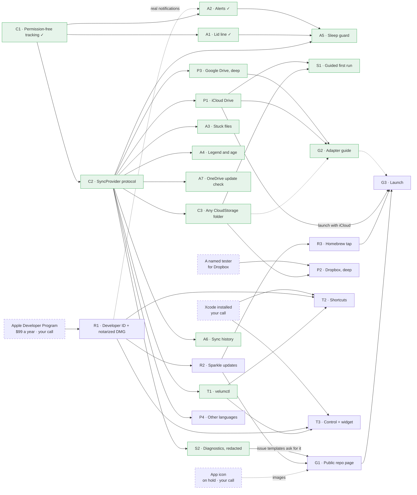

# Roadmap campaign: task cards

[All plans](../README.md) · [The consultant's memo](strategy-memo.md), the source of every card here.

November 10, 2026. Velum merges OneDrive's per-account menu bar icons into one icon and one Liquid Glass panel. Since this week it also answers "is everything in the cloud?" from macOS's own per-file sync flags, with no permissions needed. On November 10 a senior-consultant review set where Velum goes next. The review was a Fable agent sending out Haiku research scouts. Its answer: **the one sync-status light for a Mac**. That means one native icon that says whether every cloud folder is safe, whichever client syncs it, without replacing any client: "observe, don't replace; merge, don't hide."

This campaign turns every item in that memo into a card:
- the roadmap's Now, Next and Later;
- the ten ranked feature ideas;
- positioning, distribution and the launch;
- a mitigation for each of the five risks.

The few items it deliberately doesn't build are under [Left out on purpose](#left-out-on-purpose).

- [Strategy memo](strategy-memo.md): thesis, roadmap, ranked features, positioning, distribution, risks. Its evidence marks:
  - **[V]** verified by the consultant;
  - **[S]** a scout's report with sources;
  - **[U]** unverified.

  Cards keep the marks. Anything marked [S] or [U] is the first thing to check, not a fact to build on.

Each card is one session's work. Paste a card's "Brief" into a new session; it stands on its own.

## Progress

### November 13, 2026, overnight

**16 of 25 cards done, and G1 partly.** While you slept, wave 2's three code cards were built side by side in their own worktrees, then merged into `main`:
- A3, stuck files by name (merged at `22efa3d`);
- A4, what each light means and how old it is (`688874b`);
- A7, noticing when a sync app changes underneath (merged at `f07c78d`).

Two smaller changes came from what you asked on November 12, outside any card:
- **An opt-in debug log** (••• → Debug Logging, `a79be34`). OneDrive's self-update to 26.212 that evening left nothing to look back at; now status changes, alerts and failed checks can be written to `~/Library/Logs/Velum/Velum.log`.
- **The Google sign-in item always shows** (`fe0b20e`), so there is a way back in after signing out.

Wave 3 was built overnight, each card in its own worktree: G2 (the adapter guide), T1 (`velumctl`), A5 (the sleep and shutdown note) and S2 (the redacted diagnostics export) are merged, and so are A6 (sync history), C3 (any CloudStorage folder, beta) and S1 (a guided first run, from ••• → Setup…). The overnight decisions are in [Decisions the user makes](#decisions-the-user-makes), each marked "decided overnight" and yours to reverse.

### November 12, 2026

**6 of 25 cards done, and G1 partly.** Three came from the memo's "start this week":
- C1, permission-free tracking (`0a85400`);
- A1, the "Safe to close the lid?" line (`d09e180`);
- A2, problem alerts (`d09e180`).

Three were added on November 12, at your requests:
- C2, the provider protocol;
- P1, iCloud Drive, pulled forward from part two;
- P3, Google Drive in streaming mode, built overnight with your "plug-in-and-out-able" rule applied to everything.

All three were live-checked in the installed app. The panel now groups accounts under a heading per service, a layout chosen after Codex and the Fable consultant weighed in (see [P1's hand-off](cards/P1-icloud-drive.md#hand-off)).

Later on November 12, at your requests:
- **Google Drive gained storage, pause, and Start/Restart/Quit.** Storage ("214 GB free of 400 GB") comes from Google Drive's own cache, with no sign-in. "Paused" comes from its `user-paused` file. Start, Restart and Quit now work for every service with an app.
- **An optional Google sign-in** fills in storage when the cache has none. It was built in a parallel session and merged at `c8b5262`.
- **iCloud rows got "Recover Deleted Files…".**
- **The repo went public, part of G1.** You approved it after a scrub, because Google's sign-in setup needed a public home page and privacy policy. That page is a `gh-pages` site.
- **MIT** covers `main` and `gh-pages`.

These changes touched the planned cards; each has a "What changed since this card was written" note: G1, G2, R1, R2, R3, S1, S2, A4, A7, C3 and T1. See [P3's hand-off](cards/P3-google-drive.md#hand-off) for the details.

The fourth "this week" item, Developer ID enrolment, is R1 and still waits on your decision. The app icon is still on hold at your word; it now holds up only G1's images and G3, since the repo is already public.

## How it works, in one picture

```text
                       cloud folders on this Mac
   OneDrive (any number       iCloud Drive        any other folder under
   of accounts)                                   ~/Library/CloudStorage
          │                         │                        │
   OneDrive adapter           iCloud adapter          generic tier (beta)
   (C1 built it, C2 moves it)     (P1)                      (C3)
          └────────────── SyncProvider protocol (C2) ────────┘
                                    │  each folder's status, with its source and age
                                    ▼
                              Velum's Store
       ┌─────────────┬──────────────┼──────────────┬──────────────────┐
   icon + panel    alerts       lid line      velumctl JSON     Control, widget,
   A3 A4 A6        A2 A5          A1             T1             Shortcuts (T2, T3)
```

It's like a fire panel in an office building. Every floor has smoke detectors from a different maker (the sync clients). The panel replaces none of them: it reads every detector and shows one light at the front desk.

- **C2's protocol** is the standard plug that every detector's wire fits.
- **The P cards** are deep wires for particular makers, which read everything the maker exposes.
- **C3's generic tier** is a basic wire that fits any detector built on Apple's File Provider, with no special knowledge of its maker.

## Parts

The campaign follows the memo's three horizons.

- **Part one: Now** (the next few weeks): the provider-neutral core, the assurance features that build on what already works, and signed releases. Cards: C1–C2, A1–A4, A7, R1–R2.
- **Part two: Next** (one to three months): more clouds, scripting, the rest of assurance, support, Homebrew and going public. Cards: C3, P1–P3, A5–A6, T1, S1–S2, R3, G1–G3.
- **Part three: Later**, built only when real users ask for it (risk 5, scope creep). Cards: T2, T3, P4.

## Buckets

| Bucket | What it covers | Cards |
|---|---|---|
| **C** Core | One provider-neutral engine: the permission-free tracking; a `SyncProvider` protocol with OneDrive as adapter one; a generic tier for any File Provider folder | C1 ✓ → C2 · part two: C3 |
| **A** Assurance | What turns Velum from an icon tidier into sync assurance: the lid line, alerts, stuck files by name, a legend that explains every state and its age, a check that OneDrive's internals still read as expected; then a warning before sleep and a history of each account's syncing | A1 ✓, A2 ✓, A3, A4, A7 · part two: A5, A6 |
| **P** Providers | Deep adapters: iCloud Drive and Google Drive (both done November 12); Dropbox only with a named tester; OneDrive's icon text in other languages | P1 ✓, P3 ✓ · gated: P2 · later: P4 |
| **T** Tools and system surfaces | `velumctl` text and JSON for scripts, Raycast and backup jobs; then Shortcuts, a Control Center control and a widget | part two: T1 · later: T2, T3 |
| **S** Support | A guided first run; a diagnostics export that redacts itself | part two: S1, S2 |
| **R** Release | Developer ID signing, a notarized DMG, Sparkle updates, a Homebrew tap | R1 → R2 · part two: R3 |
| **G** Going public | The public repo page, an adapter guide for contributors, the launch | part two: G1, G2 → G3 |

## Cards

### Part one: Now

| Card | Result | Waits for | Runs alongside | Status |
|---|---|---|---|---|
| [C1 · Permission-free tracking as the product](cards/C1-permission-free-tracking.md) | Status from FSEvents, File Provider's per-file flags, transfer progress and OneDrive's own files. Accessibility is an opt-in extra. Every status says where it came from, and nothing says "Up to date" without evidence | nothing | nothing | **done** (`0a85400`) |
| [A1 · "Safe to close the lid?"](cards/A1-safe-to-close-the-lid.md) | One line at the top of the panel: safe, N files on the way up, some can't upload, or Velum can't vouch | C1 | A2 | **done** (`d09e180`) |
| [A2 · Problem alerts](cards/A2-problem-alerts.md) | An alert for failing uploads, a sync issue, uploads stuck for 10 minutes, or OneDrive stopping. A problem must last 30 s; it alerts once, then sends one "resolved" note. Velum's own banner stands in until R1 | C1 | A1 | **done** (`d09e180`); system notifications wait for R1 |
| [C2 · One protocol, OneDrive as adapter one](cards/C2-sync-provider-protocol.md) | A `SyncProvider` protocol, with OneDrive moved behind it and nothing visible changed. A test target pins today's behavior | C1 | R1 | **done** (November 12, with P1) |
| [A3 · Stuck files, by name](cards/A3-stuck-files.md) | Files waiting or failing past a threshold, listed in the panel with Show in Finder; the stuck alert names the first one | C2 | A4, A7, R2 | **done** November 13 (merged at `22efa3d`) |
| [A4 · What each light means, and how old it is](cards/A4-legend-and-why-unknown.md) | An icon legend. A "why is it unknown?" row saying what would make the status known. The age on every status, and old evidence shown as old | C2 | A3, A7, R2 | **done** November 13 (`688874b`) |
| [A7 · Notice when OneDrive changes underneath](cards/A7-onedrive-update-check.md) | At launch and whenever OneDrive's version changes, each OneDrive internal Velum reads is checked against a tested-version note. Anything that no longer reads is dropped as evidence, with a reason, and the status degrades to unknown | C2 | A3, A4, R2 | **done** November 13, for all three services (merged at `f07c78d`) |
| [R1 · Developer ID and a notarized DMG](cards/R1-developer-id-and-notarized-dmg.md) | Signed with your Developer ID and the hardened runtime. The app and the DMG are both notarized and stapled, with `spctl` as the gate. Real macOS notifications switch on | your enrolment | C2 | planned; **waits on your decision** |
| [R2 · Updates through Sparkle](cards/R2-sparkle-updates.md) | Sparkle with an EdDSA key, an appcast, a `RELEASING.md` modelled on Crisp's, and a GitHub Release per version | R1 | A3, A4, A7 | planned |

### Part two: Next

| Card | Result | Waits for | Runs alongside | Status |
|---|---|---|---|---|
| [P1 · iCloud Drive](cards/P1-icloud-drive.md) | iCloud Drive as adapter two: per-file flags plus `brctl status`, parsed defensively. The lid line, alerts and stuck files work for it | C2 | C3, T1, A5, A6, S2 | **done** November 12 (pulled forward at your request) |
| [C3 · Any CloudStorage folder (beta)](cards/C3-any-cloudstorage-folder.md) | Every live root under `~/Library/CloudStorage` (Dropbox, Google Drive streaming, Box, Proton, Nextcloud…) at basic fidelity, labelled beta, leftover folders ignored | C2 | P1, T1, A5, A6, S2 | **done** November 13, beta (merged at `a6f592b`); no such client on this Mac, so tested on made-up folders |
| [T1 · `velumctl`](cards/T1-velumctl.md) | A command-line tool inside the app: `velumctl status`, `lid` and `pending`, as text or `--json`, with exit codes for scripts | C2 | P1, C3, A5, A6, S2 | **done** November 13 (merged at `d776db1`; `docs/velumctl.md`) |
| [A5 · A warning before sleep or shutdown](cards/A5-sleep-and-shutdown-guard.md) | Sleep, log out or shut down with uploads pending, and Velum says so; it never blocks | C2, A1, A2 | P1, C3, T1, A6, S2 | **done** November 13 (merged at `12de79e`); the lid-close check waits for you |
| [A6 · Sync history per account](cards/A6-sync-history.md) | A small sparkline per account over the last days (uploads, waits, failures), so silent multi-day stalls become visible | C2 | P1, C3, T1, A5, S2 | **done** November 13 (merged at `822d839`) |
| [S2 · Diagnostics export, redacted](cards/S2-diagnostics-export.md) | One menu item, and `Velum --dump --redact`, that writes a report with names, emails, folders and file names replaced, ready to attach to an issue | C2 | P1, C3, T1, A5, A6 | **done** November 13 (merged at `f2135ef`) |
| [S1 · A guided first run](cards/S1-guided-first-run.md) | On first launch, Velum shows which clouds it found and which vendor icons still show. It deep-links to System Settings → Menu Bar and explains where its own icon landed | C3, P1 | G2, R3 | **built** November 13 (merged); the live check with your own menu bar settings waits for you |
| [G2 · An adapter guide](cards/G2-adapter-guide.md) | `docs/adapters.md`: the protocol, OneDrive, iCloud Drive and Google Drive as worked examples, the trust rules, and a test checklist a contributor can follow | P1, P3 (done; C3 optional) | S1, R3 | **done** November 13 (`docs/adapters.md`, `CONTRIBUTING.md`) |
| [R3 · A Homebrew tap](cards/R3-homebrew-tap.md) | `brew install --cask nafatyuk/tap/velum` from your own tap; the main Homebrew cask later | R2 (the repo is already public) | S1, G2 | planned |
| [G1 · The public repo page](cards/G1-public-repo-page.md) | A README led by the OneDrive multi-account pain, plus a screenshot and a 20-second GIF. Issue templates ask for S2's redacted report, and a Sponsor button. The switch to public is done | R2, S2 (app icon for the images) | S1, G2, R3 | **partly done**: public since November 12; the page is still to do |
| [G3 · Launch](cards/G3-launch.md) | Drafts for r/macapps, Show HN and replies in the OneDrive-icon threads the scouts found. You post them | G1, R3, P1 | nothing | planned |
| [P2 · Dropbox, deep](cards/P2-dropbox.md) | Dropbox's own state beyond the generic tier: paused, the account's status, its own errors | C3, a named tester | nothing | **gated** on a tester |
| [P3 · Google Drive, deep](cards/P3-google-drive.md) | Google Drive's own state: per-file flags, its own queue of pending work, pause, storage from its cache, an optional Google sign-in for storage, any number of accounts. Mirror mode is left for later | C2 (you maintain it) | nothing | **done** for streaming, November 12 |

### Part three: Later (only on real user requests)

| Card | Result | Waits for | Runs alongside | Status |
|---|---|---|---|---|
| [T2 · Ask Shortcuts "Is everything synced?"](cards/T2-app-intents.md) | App Intents: Is Everything Synced, Files Not in the Cloud, Open Velum; a spike first | T1, R1, Xcode | T3, P4 | later |
| [T3 · A Control and a widget](cards/T3-control-and-widget.md) | A Control Center and menu bar Control plus a desktop widget showing the one light, fed by a shared snapshot | T1, R1, Xcode | T2, P4 | later |
| [P4 · OneDrive's icon text in other languages](cards/P4-other-languages.md) | The exact-status path (Accessibility) classifies OneDrive's text in the languages OneDrive ships, not just English | C2 | T2, T3 | later |

## What waits for what

Arrows mean the card at the arrow's tail must be committed to `main` first. Dashed boxes are your decisions, not cards.



| Wave | Cards | Why |
|---|---|---|
| 1 | C2, R1 | C2 touches nearly every Swift file, so no other code card runs beside it. R1 touches only the build and signing scripts and `Info.plist`, and starts once you have enrolled. |
| 2 | A3, A4, A7, R2 | Each owns a new file of its own plus marked lines in shared files. R2 needs R1's signed build. |
| 3 | P1, C3, T1, A5, A6, S2 | All need C2's protocol. P1 and C3 own different adapters; T1 and S2 add their own entry points; A5 and A6 own new files. |
| 4 | S1, G2, R3 | S1 and G2 need real adapters to describe: three exist now, so G2 can start any time. R3 needs a Sparkle-era release to point at. |
| 5 | G1 (the page) | The repo is already public. The page waits for a release and S2's redacted report, which the issue templates ask for, and the icon for its images. |
| 6 | G3 | Launch once: signed, on Homebrew, with iCloud Drive. |
| Gated | P2 | Only with a named tester (risk 3, adapters for clients you don't use). P3 needed no gate: you use Google Drive. |
| Later | T2, T3, P4 | Only on real user requests (risk 5). T2 and T3 also need Xcode, which this Mac doesn't have: the Command Line Tools have no App Intents metadata processor and no extension templates. |

The longest chain is your enrolment → R1 → R2 → R3 → G3. The icon starts a second chain, icon → G1 → G3, which can finish no sooner than R2 does.

## Decisions the user makes

Collected here so they can be made in one sitting. Each card repeats its own.

| Card | Decision | Suggested |
|---|---|---|
| R1 | Join the Apple Developer Program ($99 a year) | Yes, before going public. Without it, three problems: macOS 15 and later make everyone click "Open Anyway"; Homebrew casks must pass Gatekeeper [V/S]; macOS refuses Velum's notifications (verified this week). The consultant's funding answer: free forever, with sponsors covering the fee |
| R1 | Universal build, or Apple silicon only | Universal, if the Command Line Tools can build the Intel half (R1 finds out); otherwise Apple silicon only, said in the README |
| R2 | Sparkle's update check would be Velum's second network use (after the optional Google sign-in): check automatically, or ask on first run | Sparkle's own first-run question; the README's network sentence names both, each only if you allow it |
| R2 | Where the update feed lives | On the existing `gh-pages` site (`nafatyuk.github.io/velum/appcast.xml`), so Google's links keep working |
| A2 | Once system notifications work: keep the "resolved" follow-up, or errors only (the consultant's default) | Keep as built: each problem, then one "resolved" note |
| A3 | How long before a file counts as stuck | **Decided overnight:** 10 minutes, the suggested value; the defaults key `stuckAfterSeconds` changes it |
| A5 | Warn only, or also hold off sleep briefly while uploads finish | **Decided overnight:** warn only, the suggested answer; macOS 27 gives an app no way to delay shutdown anyway |
| A6 | How much history to keep | **Decided overnight:** 30 days, on this Mac only, as counts (never file names) |
| C3 | Show the generic tier's folders by default, or behind a switch | **Decided overnight:** shown, each labelled beta, with ••• → Show Other Cloud Folders to turn them off; while one shows, the lid line can't say "Safe" |
| G1 | The app icon | On hold, your call |
| G1 | When the repo goes public, and whether `docs/plans/` goes public with it | **Decided November 12:** public now, plans included, after a scrub |
| G1 | Sponsor links: GitHub Sponsors, Ko-fi, both, or none | GitHub Sponsors only |
| G3 | Where and when to post; you post | Once, after G1: r/macapps and Show HN, then replies in the OneDrive-icon threads |
| P2 | Who tests Dropbox (you don't use it) | Nobody yet: leave it gated |
| P3 | Who maintains Google Drive | **Decided November 12:** you; done for streaming mode |
| T2, T3 | Install Xcode | Only when someone asks for these |
| Debug log | Whether a failing file's name may appear in the opt-in debug log. A3 raised it: its card kept names out of logs | **Decided overnight:** yes. The log is off unless you turn it on, stays on this Mac, and the panel already shows the same name; S2's export redacts it before anything leaves the Mac. Removing it is one line in `DebugLog.changes` |

## Rules every card follows

- Read this page, [the memo](strategy-memo.md), [the README](../../../README.md) and your card before writing code.
- **Ask the user where the work goes** (the main checkout on `main`, or a worktree) before you start. Ask again before committing, and again before pushing.
  - Commits use the repo's own noreply identity (`git config user.email` in this repo); never change it.
  - Don't open pull requests or make branches of your own.
- **Never assume OK.** Velum never says "Up to date", "safe" or green without evidence it can name.
  - Every status carries its source and its age.
  - When the evidence runs out, the answer is `.unknown` with a reason.
  - A false "synced" is the worst bug this app can have (risk 4).
- **Observe, don't replace.**
  - No network connections. R2's update check is the one exception, and only as you decide.
  - No credentials. Never write a sync client's files or settings.
  - The only things Velum does to a client are commands the user clicks (Restart, Quit).
- **The user's cloud folders are theirs.**
  - Writing a probe file into a synced folder needs the user's yes each time.
  - Delete probes afterwards, and only once the last edit has settled (about 75 s); OneDrive restores a file deleted mid-sync.
  - Test fixtures are synthetic. Never copy the user's real OneDrive databases or logs into the repo: they hold file names.
- **System and security settings are the user's:**
  - Accessibility and the other privacy permissions;
  - System Settings → Menu Bar;
  - MenuBarAgent's preferences.

  Cards may open the right pane; they never change it.
- **Looks:** new UI follows the panel:
  - macOS 27 Liquid Glass;
  - the shell taken from Crisp (a non-activating panel on `NSGlassEffectView`);
  - SF Symbols and the panel's existing row styles.

  Borrow from Crisp (MIT) freely, and record what you took in `THIRD_PARTY_NOTICES.md`.
- **Build:** `./build.sh` uses the Command Line Tools only, so there is no `@State` macro: use `State(initialValue:)`. `./build.sh --install` replaces the running app: ask first.
- **Tests:** `swift test`; Swift Testing works with the Command Line Tools on this Mac.
  - C2 creates `Tests/VelumTests`, and each later card adds its own test files there.
  - Live checks use `Velum --dump`, which prints what the panel would show.
- **Diagnostics:** `log show` returns nothing from an agent session on this Mac. Write what you need into Velum's own defaults or into `--dump`.
- **Codex in the background:** `codex exec … < /dev/null`, or it hangs waiting for input.
- When you finish, fill in the **Hand-off** at the bottom of your card (what you built, what you left out, anything a later card must know) and commit it with your work.

## Who owns which files

| Card | Owns |
|---|---|
| C2 | New `Sources/Velum/Providers/` (`SyncProvider.swift`, `OneDrive/`); what moves there out of `Model.swift`, `OneDriveFiles.swift` and `LiveStatus.swift`; the test target in `Package.swift`; `Tests/VelumTests/` |
| A3 | A listing method on `UploadTracker`, `StuckFilesView.swift`, the stuck alert's text in `Notifier.swift` |
| A4 | `LegendView.swift`, the age text in `AccountRow`, the `.unknown` reasons in the OneDrive adapter |
| A7 | `Providers/OneDrive/Compatibility.swift`, the README's tested-version line |
| R1 | `build.sh`, `Scripts/` (signing, `release.sh`, `build-dmg.sh`), `Resources/Velum.entitlements`, `Info.plist`'s version keys |
| R2 | The Sparkle dependency, `Updater.swift`, `appcast.xml` on the `gh-pages` branch, `RELEASING.md`, the ••• menu's Check for Updates… |
| P1 | `Providers/iCloud/` |
| C3 | `Providers/Generic/` and the root discovery |
| T1 | `Sources/velumctl/`, its product in `Package.swift`, its copy step in `build.sh` |
| A5 | `SleepGuard.swift` |
| A6 | `History.swift`, `SparklineView.swift` |
| S2 | `Diagnostics.swift` (export and redaction), the ••• menu's Export Diagnostics…, `--redact` in `Entry.swift` |
| S1 | `FirstRunView.swift` and its first-launch flag |
| G2 | `docs/adapters.md` |
| R3 | The tap, a separate repository (`nafatyuk/homebrew-tap`) |
| G1 | `README.md`, images under `docs/`, `.github/ISSUE_TEMPLATE/`, `.github/FUNDING.yml` |
| G3 | Drafts outside the repo, in `~/Local Documents/Velum/launch/` |
| P2 | `Providers/Dropbox/` |
| P3 (done) | `Providers/GoogleDrive/` |
| P4 | The OneDrive adapter's text classification and its tests |
| T2, T3 | The Xcode or XcodeGen project and the extension targets |

**Shared files, edited only on your own lines with exact-string edits:**
- `PanelView.swift`: one line per new section, one line per new ••• menu item;
- `AppDelegate.swift`: one line per thing started at launch;
- `Package.swift`;
- `build.sh`;
- the README's "What you get" list.

## Left out on purpose

- **Becoming a sync client or mounter.** SyncTray, ExpanDrive, CloudMounter and Mountain Duck replace the vendor's client; Velum observes it.
- **A menu bar manager.** Ice, Bartender, Thaw and macOS's own Allow in the Menu Bar hide icons. Velum merges status; it doesn't manage other apps' icons.
- **Per-provider settings front ends, and anything networked or holding credentials.**
- **The Mac App Store.** Its sandbox stops Velum reading other apps' files and processes [S].
- **Setapp** [S, low–medium confidence].
- **A Focus filter.** There are reports of `perform()` never being called on macOS 26.5 [S, low]. Revisit if Apple fixes it.
- **A new name.** Velum stays: it fits more than one cloud.
- **Risk 2, Apple or Microsoft fixing the icons themselves.** It gets no card of its own. The multi-provider and assurance cards are the answer, because they outlive the icon problem.
